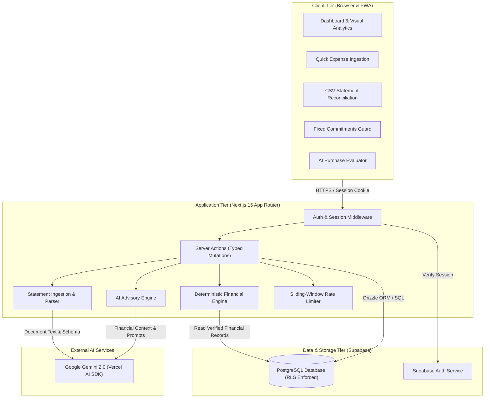

# Spend Control

Spend Control is a proactive financial intelligence application designed to give users clear visibility and conscious command over their daily finances. 

Unlike passive retrospective ledgers that only report where money went after it was spent, Spend Control connects daily expense tracking with recurring debt obligations (rent, loan EMIs, utilities), delivering forward-looking purchase decision support.

---

## Key Features

- **Financial Command Center**: Real-time calculation of total liquid availability, committed monthly burn, and safe daily discretionary spending limits.
- **Fixed Commitment Shields**: Prioritizes rent, loan EMIs, insurance, and recurring subscriptions before calculating spendable surplus.
- **Frictionless Daily Expense Ingestion**: Fast multi-currency expense logging with instant base currency normalization, category breakdown, and search filtering.
- **Bank Statement Reconciliation**: CSV statement parser with automatic column detection, heuristic categorization, and staged row editing.
- **Forward-Looking AI Advisor**: Evaluates wishlist items against a 60-day debt shield and provides concrete verdicts (`BUY NOW`, `DEFER`, or `TARGET DATE`) backed by deterministic arithmetic proofs.
- **Guided User Onboarding**: 4-step interactive configuration wizard for currency selection, initial account setup, and baseline commitments.
- **Mobile First & PWA Ready**: Native touch-optimized bottom navigation dock ($\ge 44\text{px}$ touch targets), Web App Manifest, and standalone iOS/Android support.
- **Multi-Tenant Security**: 100% of tables enforce PostgreSQL Row Level Security (RLS) so tenant data is strictly partitioned by user identity.
- **Rate-Limited Protection**: In-memory sliding-window rate limiters safeguarding AI endpoints against abuse.

---

## Architectural Principles

1. **Deterministic Calculations First**:
   All financial metrics (liquid balances, burn rates, safety reserves, and daily spending velocity) are calculated using tested TypeScript formulas. The application never relies on an LLM to perform arithmetic.
2. **AI as Advisor, Not Accountant**:
   The AI engine receives pre-calculated deterministic financial figures and provides qualitative advice, scenario evaluation, and unstructured document parsing.
3. **Multi-Tenancy by Default**:
   Every database table holds a `user_id` foreign key referencing the authenticated Supabase user with active PostgreSQL Row Level Security policies.
4. **Anti-Slop Craftsmanship**:
   Adheres to a restrained Black and Gold visual palette (`#09090b` dark surfaces, `#d4af37` gold accents), zero em dashes in UI copy, and WCAG AA contrast standards.

---

## System Architecture



---

## Tech Stack

| Layer | Technology |
| :--- | :--- |
| **Framework** | Next.js 15 (React 19, App Router, Server Components) |
| **Language** | TypeScript (Strict mode enabled) |
| **Styling** | Tailwind CSS v4 with Black and Gold theme tokens |
| **UI Components** | shadcn/ui style accessible primitives (Button, Card, Badge) |
| **Icons** | Lucide React |
| **Visual Charts** | Recharts (Area velocity chart, Category donut, Cash flow bars) |
| **Database & Auth**| PostgreSQL hosted on Supabase with Row Level Security (RLS) |
| **ORM & Migrations**| Drizzle ORM and Drizzle Kit |
| **AI Integration** | Vercel AI SDK (`ai`, `@ai-sdk/google`) powered by Gemini 2.0 |
| **File Parsing** | PapaParse for bank CSV records |
| **Validation** | Zod schemas for all forms and server action payloads |

---

## Getting Started

### Prerequisites

- Node.js 20+ installed
- npm (or pnpm / yarn)

### 1. Clone & Install Dependencies

```bash
git clone <repository-url>
cd "Spend Control"
npm install
```

### 2. Configure Environment Variables

Copy the example environment configuration:

```bash
cp .env.example .env.local
```

Populate the keys in `.env.local`:

```env
# Supabase Configuration
NEXT_PUBLIC_SUPABASE_URL=https://your-project.supabase.co
NEXT_PUBLIC_SUPABASE_ANON_KEY=your-anon-key
SUPABASE_SERVICE_ROLE_KEY=your-service-role-key

# AI Advisory Engine (Google Gemini)
GOOGLE_GENERATIVE_AI_API_KEY=your-gemini-api-key
```

*(Note: The application includes local fallback mechanisms so you can run and evaluate all UI workflows and deterministic calculations without live cloud keys).*

### 3. Apply Database Migrations (Optional for Cloud Setup)

When connecting to a live Supabase instance:

```bash
npx drizzle-kit push
```

### 4. Run the Development Server

```bash
npm run dev
```

Open [http://localhost:3000](http://localhost:3000) in your browser.

---

## Available Scripts

| Command | Description |
| :--- | :--- |
| `npm run dev` | Starts the Next.js local development server on port 3000. |
| `npm run build` | Compiles an optimized production build and validates static routes. |
| `npm start` | Starts the production server using the compiled build. |
| `npm run typecheck` | Runs the TypeScript compiler (`tsc --noEmit`) to verify strict typing. |
| `npm run lint` | Runs Next.js ESLint validation across all source files. |

---

## Testing & Quality Verification Suite

To run all unit sanity checks, security audits, and type verification:

```bash
# 1. Strict static type checking
npm run typecheck

# 2. Code style & linting
npm run lint

# 3. Deterministic calculation engine tests
npx tsx src/lib/finance/calculations.test.ts

# 4. AI advisor logic & 60-day debt shield tests
npx tsx src/lib/ai/advisor.test.ts

# 5. Bank statement CSV parser tests
npx tsx src/lib/ingest/parser.test.ts

# 6. Sliding-window rate limiter tests
npx tsx src/lib/security/rate-limit.test.ts

# 7. Multi-tenant PostgreSQL RLS policy static audit
npx tsx src/lib/security/rls-audit.test.ts

# 8. Anti-slop check: verify zero em dashes in source code
grep -rn "—" src/ || echo "PASS: Zero em dashes detected"
```

---

## Project Structure

```
spend-control/
├── drizzle/                      # PostgreSQL DDL migrations with RLS policies
│   ├── 0000_init_users_rls.sql
│   ├── 0001_accounts_and_commitments_rls.sql
│   ├── 0002_transactions_rls.sql
│   ├── 0003_statement_uploads_rls.sql
│   └── 0004_wishlist_items_rls.sql
├── specs/                        # Architecture constitution & phase specifications
│   ├── mission.md                # Product mission, audience, and non-goals
│   ├── tech-stack.md             # Library choices and constraints
│   ├── Overall_Architecture-Flow.md # System flow and database schema
│   ├── roadmap.md                # Phased milestones checklist
│   └── 2026-11-22-phase-*/       # Requirements, plans, and validation for each phase
├── src/
│   ├── app/                      # Next.js 15 App Router
│   │   ├── auth/                 # Supabase Auth Server Actions and callbacks
│   │   ├── dashboard/            # Authenticated application shell
│   │   │   ├── accounts/         # Liquid accounts & cash reserve management
│   │   │   ├── commitments/      # Fixed recurring obligations & loan shields
│   │   │   ├── transactions/     # Daily expense logging & category ledger
│   │   │   ├── import/           # CSV statement reconciliation view
│   │   │   └── advisor/          # AI purchase evaluator & wishlist tracking
│   │   ├── login/                # Email sign-in and sign-up page
│   │   ├── manifest.ts           # PWA web app manifest route
│   │   ├── layout.tsx            # Global root layout with theme provider
│   │   └── page.tsx              # Public landing page and feature simulator
│   ├── components/               # UI components
│   │   ├── ui/                   # Button, Card, Badge primitives
│   │   ├── charts/               # Recharts components (burn rate, category donut, cash flow)
│   │   ├── mobile-bottom-nav.tsx # Fixed 5-tab mobile navigation dock
│   │   └── onboarding-wizard.tsx # 4-step guided configuration modal
│   ├── lib/
│   │   ├── ai/                   # Advisor logic, prompts, and evaluation tests
│   │   ├── db/                   # Drizzle schema definition and connection client
│   │   ├── finance/              # Pure financial calculation functions & tests
│   │   ├── ingest/               # CSV parser and extraction routines
│   │   ├── security/             # Rate limiting engine and RLS audit suite
│   │   └── supabase/             # Server and browser Supabase client factories
│   └── middleware.ts             # Session validation and route protection
├── AGENTS.md                     # Operating rules and anti-slop guidelines for AI agents
├── package.json
└── tsconfig.json
```

---

## Production Deployment

### Deploying to Vercel

1. Push your repository to GitHub:
   ```bash
   git remote add origin https://github.com/<your-username>/spend-control.git
   git push -u origin main
   ```
2. In the [Vercel Dashboard](https://vercel.com), select **Add New Project** and import the repository.
3. In **Settings -> Environment Variables**, add:
   - `NEXT_PUBLIC_SUPABASE_URL`
   - `NEXT_PUBLIC_SUPABASE_ANON_KEY`
   - `SUPABASE_SERVICE_ROLE_KEY`
   - `GOOGLE_GENERATIVE_AI_API_KEY`
4. Click **Deploy**. Vercel will build and serve the application globally.

---

## License

Private and proprietary. All rights reserved.
