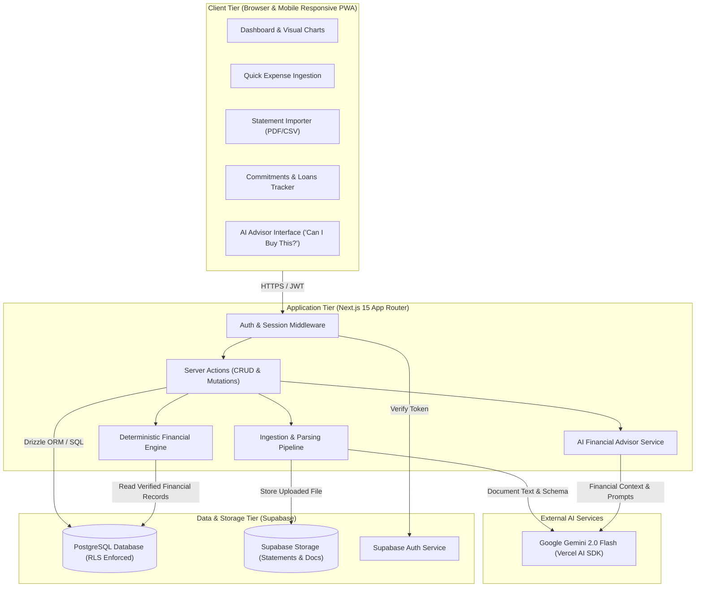
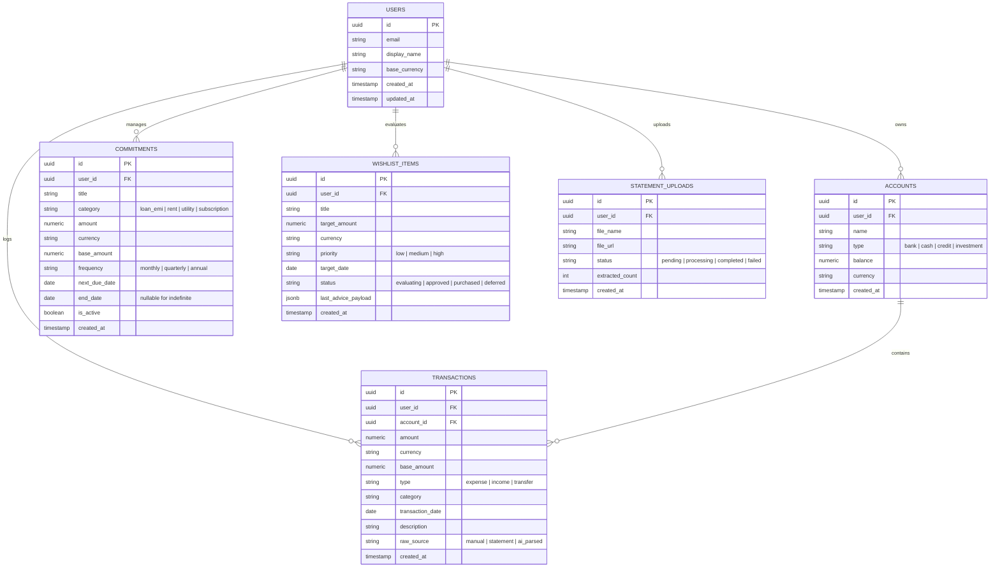
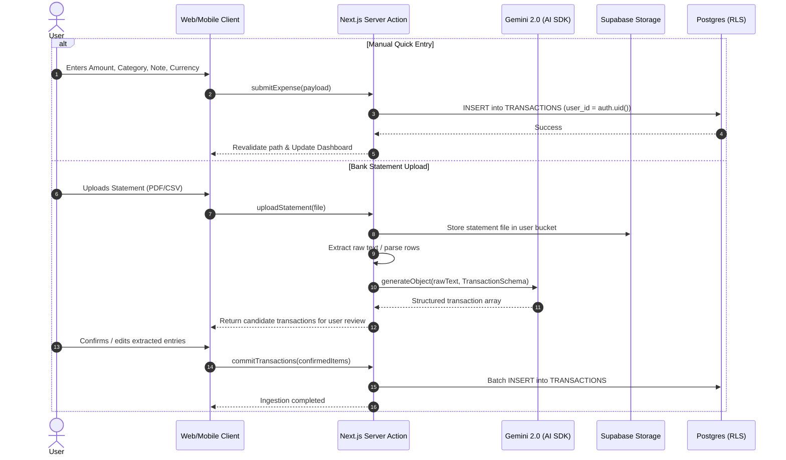
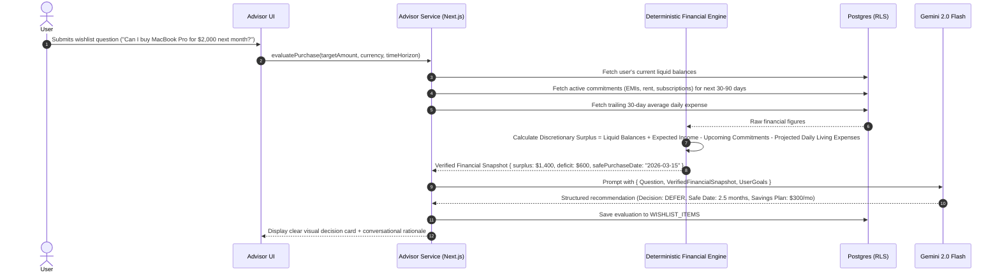

# Spend Control — Overall Architecture & Execution Flow

This document details the system design, data architecture, and end-to-end execution flows for Spend Control.

---

## 1. System Architecture

---

## 2. Data Model & Entity Relationships

---

## 3. End-to-End Execution Flows

### 3.1 Daily Expense Ingestion Flow (Manual & Statement Upload)

### 3.2 AI Financial Advisor: "Can I Buy This Product?" Flow

